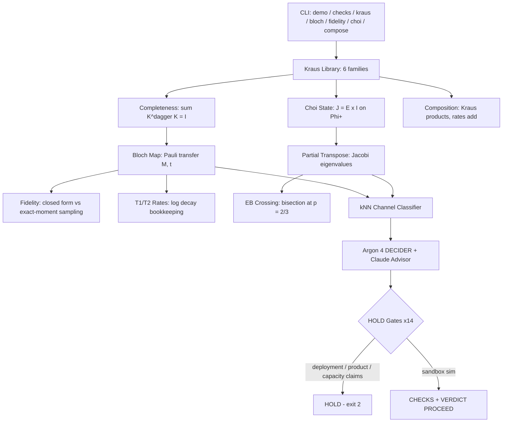
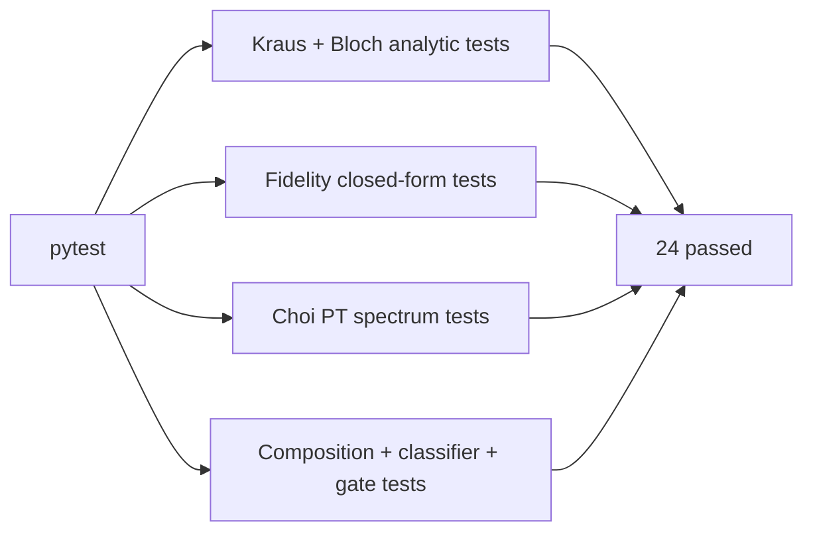
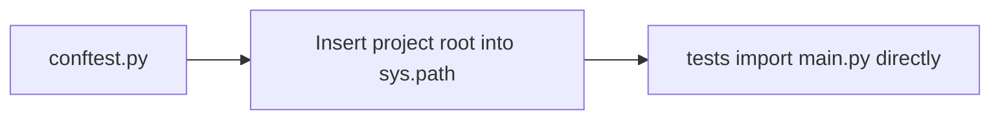
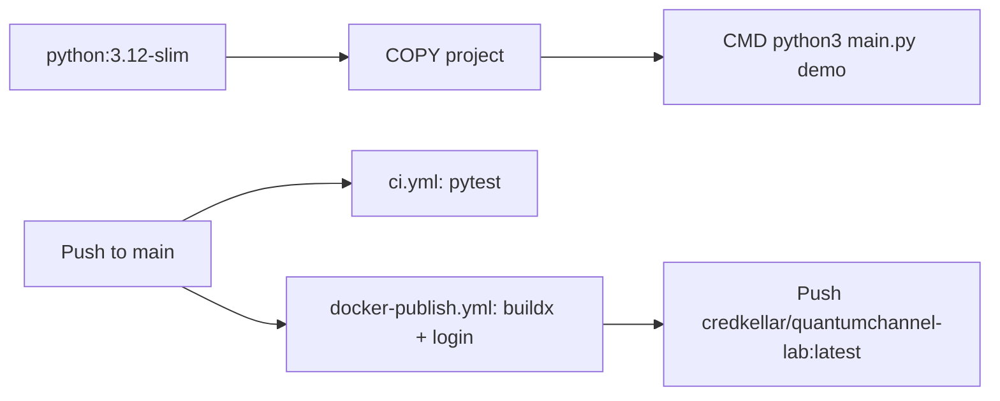

# QuantumChannel-Lab 📡⚛️

**Single-Qubit Quantum Channel Lab — Kraus Operators, Bloch Maps, Choi States & Entanglement Breaking** — by Darion Kellar

QuantumChannel-Lab is an **educational single-qubit quantum channel lab** in ONE pure-Python file. It takes the six textbook noise channels — bit flip, phase flip, bit-phase flip, depolarizing, amplitude damping, phase damping — and computes **four views of each one from the same Kraus operators**, grading every view against the others and against closed forms:

- the **Kraus view**: the operators themselves, with completeness `Σ K†K = I` asserted to 2.22e-16 on the whole parameter grid;
- the **Bloch view**: the affine map `r → M r + t` read off the Kraus operators by applying them to the Pauli operators, reproducing direct density-matrix evolution to under 1e-12 on a 30-point sphere grid;
- the **fidelity view**: average gate fidelity against the identity, computed by a closed form from the Bloch matrix *and* by direct sampling over a 26-point exact-moment point set — the two agree to 2.22e-16;
- the **Choi view**: the normalised Choi state and its partial transpose, whose smallest eigenvalue says exactly where a channel starts breaking every entangled state fed through it — for depolarizing, bisected at **p\* = 0.666666667**, the exact 2/3.

Honest scope, stated up front: this is **one qubit and Markovian noise**. No real device was measured, no real channel was characterised, and **no channel capacity, key rate, or hardware figure is computed or claimed anywhere** — those uses are permanent HOLD gates (14 total). 🔒

[](https://github.com/kimanicollier44-cmyk/QuantumChannel-Lab/actions/workflows/ci.yml)
[](https://github.com/kimanicollier44-cmyk/QuantumChannel-Lab/actions/workflows/docker-publish.yml)

> ℹ️ These are the **live** workflow badges for this repo. They activate as soon as the `ci.yml` and `docker-publish.yml` files from the paste pack are pasted into `.github/workflows/` — until then they have nothing to report yet.

## 🧰 Tech Stack Badges & Full Architecture Tech Stack

### 💻 Core Programming Languages & Core Systems


- 🐍 Python 3.12, pure standard library (`math`, `cmath`, `hashlib`, `json`, `sys`) — zero dependencies, zero network, deterministic (double-run byte-identical)
- 📡 Channel core from scratch: a complex matrix kit (products, daggers, Kronecker products) written out in full, six Kraus families, the Pauli-transfer Bloch map `M[i][j] = ½ Tr[σ_i E(σ_j)]`, `t[i] = ½ Tr[σ_i E(I)]`, and a cyclic **Jacobi eigensolver** for Hermitian matrices (phase-then-rotate sweeps) that is refereed against known spectra before it is trusted with the Choi state
- 🎯 Fidelity referee: the closed form `F_avg = ½ + Tr(M)/6` graded against direct sampling on a 26-point set (octahedron + cube + icosahedron) whose first and second moments match the sphere exactly — agreement is a check, not an assumption
- 🔗 Choi core: `J = (E ⊗ I)(|Φ+⟩⟨Φ+|)` built block by block, partial transpose by index rule, entanglement breaking decided by the smallest PT eigenvalue (exact for qubit channels by Peres–Horodecki)
- 🧠 TinyML kNN channel classifier (from scratch, stdlib, distance-weighted): near-identity / depolarizing / damping-dominated / entanglement-breaking from (Bloch shrink factors, |t|, Choi PT minimum), labels from the lab's own policy
- 🪑 Council seats: Gemini Argon 4 DECIDER (names-only, tighten-only) + Muse advisor (never overrides HOLD) + Google Flow plan-only (rendered = False, live = 0)

### ⛓️ Web3 & Infrastructure

- 🚫 **Not applicable — honestly.** No blockchain, no Web3, no tokens: the "infrastructure" in this lab is one offline file holding six Kraus families and a Choi state. Quantum-network deployment and QKD security claims are permanent HOLD gates, not features. No fake badges here.

### ⚙️ Platform Support & Hardware Architecture


- 🖥️ Pure Python — runs anywhere Python 3.12+ runs (Linux, macOS, Windows), plus the `python:3.12-slim` Docker image
- 🔒 No hardware is controlled, ever: real qubits, links, and readout chains are permanent HOLD gates (see the gate table below)

### ⚡ Low-Level Infrastructure & Performance

- 🚫 **No low-level code — honestly.** No C, no C++, no GPU, no compiled extensions: this is one interpreted Python file on purpose, so every matrix entry can be read, checked, and diffed. Performance here means honest algorithms — a Jacobi eigensolver instead of a library call, a 200-step bisection for the entanglement-breaking crossing, exact-moment sampling instead of Monte Carlo — all deterministic and byte-identical between runs.

### 🛠️ DevOps & Build Tools


- 🐳 Docker (`python:3.12-slim`), GitHub Actions CI + Docker Publish (delivered in the paste pack)
- 🎯 Target image: `credkellar/quantumchannel-lab:latest`
- 🧪 Tests: `pytest` (24 tests) + the built-in CHECKS suite (52 checks) in `main.py`

### ☁️ Cloud Providers

- 🚫 **None — honestly.** No cloud provider is used or needed: the lab runs fully offline on your own machine or in a local Docker container. Docker Hub appears only as the registry the publish workflow pushes the image to.

## What this does?

1. 🧰 **Kraus library** — six channel families (bit flip, phase flip, bit-phase flip, depolarizing, amplitude damping, phase damping), each a builder returning explicit 2×2 Kraus operators. Completeness `Σ K†K = I` is asserted to **2.22e-16** for every family on the full parameter grid (0, 0.1, 0.25, 0.5, 0.75, 0.9, 1) — a channel that leaks probability is caught before anything else runs.
2. 🎱 **Bloch affine map, derived not quoted** — the channel is applied to the Pauli operators themselves to read off `M` and `t`, then the affine map is graded against direct density-matrix evolution on a 30-point sphere grid (agreement < 1e-12). The physics falls out: depolarizing is the uniform shrink `M = (1 − p) I`; amplitude damping gives `M = diag(√(1−γ), √(1−γ), 1−γ)` with the drag `t = (0, 0, γ)` toward |0⟩.
3. ⏱️ **T1/T2 bookkeeping** — per amplitude-damping step, populations shrink by `(1 − γ)` and coherences by `√(1−γ)`, so the coherence log-rate is **exactly half** the population log-rate (at γ = 0.5: 0.346574 vs 0.693147, ratio 2.000000) — the `T2 = 2·T1` limit of pure amplitude damping, shown as arithmetic on the computed Bloch factors.
4. 🎯 **Average gate fidelity, refereed** — `F_avg = ½ + Tr(M)/6` (the translation `t` provably drops out of the sphere average) graded against direct sampling on a 26-point set whose moments match the sphere exactly: worst disagreement **2.22e-16** across all families and grid parameters. Headlines: depolarizing `F_avg = 1 − p/2` under the stated convention, bit flip `1 − 2p/3`, amplitude damping 0.819036 at γ = 0.5.
5. 🔗 **Choi state** — `J = (E ⊗ I)(|Φ+⟩⟨Φ+|)` built explicitly (trace exactly 1, eigenvalues ≥ 0 — the CP receipt), with a from-scratch Hermitian Jacobi eigensolver that is first refereed on known spectra (Pauli Y, a complex 2×2, X⊗X + Z⊗Z → {−2, 0, 0, 2}).
6. ✂️ **Entanglement breaking, located** — the partial transpose's smallest eigenvalue is matched to closed forms on the whole grid: depolarizing `(3p − 2)/4`, bit flip `−|1 − 2p|/2`, phase damping `−√(1−λ)/2`. Bisection on the computed eigenvalue puts the depolarizing entanglement-breaking crossing at **p\* = 0.666666667** (exact 2/3); amplitude damping's PT minimum stays below −1e-3 for every γ ≤ 0.9 and reaches 0 only at γ = 1 — it is entanglement-breaking only when it has already destroyed everything.
7. 🧩 **Composition** — channels compose by Kraus multiplication; the composed Bloch map equals the product of the maps (asserted on the sphere grid). Phase damping after amplitude damping makes the coherence log-rate **add**: at γ = 0.3, λ = 0.2 the rate is 0.289909 = T1-rate/2 (0.178338) + pure dephasing rate (0.111572), and `T2 ≤ 2·T1` is verified across the whole (γ, λ) sweep — with equality exactly when λ = 0.
8. 🔁 **Iterated decay, measured off the states** — applying the composed channel 40 times to |+⟩ and |1⟩ leaves coherence 9.1994e-06 and population 6.3668e-07, matching the power laws `(√(1−γ)√(1−λ))^40` and `(1−γ)^40` — the rates are read from real iterated states, not just from the map.
9. 🏷️ **Channel classifier** — a from-scratch distance-weighted kNN over the lab's own policy labels computed channels near-identity / depolarizing / damping-dominated / entanglement-breaking from (smallest/largest Bloch shrink, |t|, Choi PT minimum): depolarizing at p = 0.8 and full amplitude damping land in entanglement-breaking, phase flip at p = 0.5 (complete dephasing) lands there too, and kNN == policy is asserted on every scenario and all 640 grid rows.
10. 🪑 **Seats + checks** — Gemini Argon 4 DECIDER (sha256 trace, tighten-only), Muse advisor, Google Flow plan-only, 14 permanent HOLD gates, and a built-in CHECKS suite (52 checks) that re-derives every headline number above.

## 🗺️ How it works — diagram per script

### `main.py` — the whole lab



### `tests/test_main.py` — verification



### `conftest.py` — test path setup



### `Dockerfile` + CI flow — container & publish



## Why is this cool?

1. 🎱 The Bloch map is **derived in the open**: the channel is applied to the Pauli operators themselves, so `M` and `t` are computed objects that then have to survive a head-on comparison with direct evolution — no formula is ever just quoted.
2. 🎯 The fidelity referee is **exact, not statistical**: the 26 sampling points are chosen so their first and second moments match the sphere perfectly, which turns "sampling vs closed form" into a machine-precision identity (2.22e-16) instead of a Monte-Carlo shrug.
3. ✂️ Entanglement breaking gets a **bisected address**: p\* = 0.666666667, found by halving an interval on the computed PT eigenvalue 200 times — and the eigenvalue itself is matched to `(3p − 2)/4` at every grid point first.
4. ⏱️ `T2 = 2·T1` stops being a slogan: it is the ratio of two logarithms of numbers the lab computed from Kraus operators, and it comes out 2.000000.
5. 🧩 Composition is **proved on states**: after 40 composed applications, the surviving coherence measured off the density matrix matches the predicted power law to the printed digits — rates add because the factors multiply, and the lab shows both sides.
6. 🔗 The Choi state does double duty: its own spectrum is the CP receipt (all eigenvalues ≥ 0, trace exactly 1), and its partial transpose is the entanglement autopsy — one matrix, two verdicts.
7. 🛠️ The eigensolver is **home-made and refereed**: a cyclic Jacobi routine that must first reproduce {−1, +1} for σ_y and {−2, 0, 0, 2} for X⊗X + Z⊗Z before it is allowed near the Choi state.
8. 🏷️ The classifier's features are **physical, not decorative**: shrink factors, translation length, and the PT minimum — so its verdicts (including "phase flip at p = 0.5 is entanglement-breaking", i.e. complete dephasing) can be argued with, number by number.
9. 📏 Conventions are **printed before numbers**: depolarizing means `(1 − p)ρ + p·I/2` here, the Choi state is normalised, the channel acts on the first qubit — the three choices that silently change every published "2/3" are stated once, up front.
10. 🎯 Deterministic end to end: run it twice, get byte-identical output — a channel lab you can diff.

## What problems this solves?

1. ❌ **Problem:** "Depolarizing" means different things in different papers, and fidelities shift with the convention. ✅ **Solution:** The convention `E(ρ) = (1 − p)ρ + p·I/2` is stated once and used everywhere, and `F_avg = 1 − p/2` is asserted under exactly that convention.
2. ❌ **Problem:** Bloch pictures in textbooks are drawn, not derived. ✅ **Solution:** `M` and `t` are computed from the Kraus operators via the Pauli transfer and graded against direct evolution on 30 sphere points.
3. ❌ **Problem:** Average fidelity is usually quoted from a formula nobody checks. ✅ **Solution:** Two independent computations — closed form and exact-moment sampling — must agree to 1e-9 (they agree to 2.22e-16) across every family and parameter.
4. ❌ **Problem:** "Entanglement-breaking" is asserted from memory of a threshold. ✅ **Solution:** The PT eigenvalue is computed by a refereed Jacobi solver, matched to three different closed forms, and the crossing is bisected, not recalled.
5. ❌ **Problem:** T1/T2 relations get repeated without the mechanism. ✅ **Solution:** The lab shows the per-step factors `(1 − γ)` and `√(1−γ)` on the Bloch z and x axes and lets the factor-of-2 fall out of the logarithms.
6. ❌ **Problem:** Adding dephasing to damping is often hand-waved as "T2 gets worse". ✅ **Solution:** Log-rate additivity is asserted numerically (`rate = T1/2 + dephasing`) and the `T2 ≤ 2T1` inequality is swept, with equality isolated at λ = 0.
7. ❌ **Problem:** Channel composition in code often silently breaks trace preservation. ✅ **Solution:** Composed Kraus sets are re-checked for completeness, and the composed Bloch map must equal the product of the individual maps on the sphere grid.
8. ❌ **Problem:** Amplitude damping is described as "just decay", hiding that it is *not* entanglement-breaking until it is total. ✅ **Solution:** Its PT minimum is printed across the γ grid — negative all the way to γ = 0.9, touching zero only at γ = 1.
9. ❌ **Problem:** Toy noise models quietly become hardware claims. ✅ **Solution:** 14 named HOLD gates (network deployment, error-correction products, vendor figures, capacities, QKD security…) return exit code 2, permanently.
10. ❌ **Problem:** Simulation code with a library eigensolver inside can't be audited by a student. ✅ **Solution:** Every linear-algebra step — Kronecker products, Jacobi rotations, bisection — is written out in stdlib Python in the one file.

## How to install this?

1. 📋 Clone or download this project folder.
2. 🐍 Make sure Python 3.12+ is installed: `python3 --version`
3. ▶️ Run the full demo + checks (no arguments needed):

```bash
python3 main.py
```

4. 🧪 Run the test suite:

```bash
pip install pytest
python3 -m pytest -q
```

5. 🎛️ Try the other commands:

```bash
python3 main.py checks    # 52 built-in checks
python3 main.py kraus     # Kraus library + completeness report (JSON)
python3 main.py bloch     # Bloch M diag + t per channel (JSON)
python3 main.py fidelity  # F_avg closed form vs sampling (JSON)
python3 main.py choi      # Choi spectra, PT minima, EB crossing (JSON)
python3 main.py compose   # composed rates + iterated decay (JSON)
python3 main.py classify  # kNN channel classifier report
python3 main.py brains    # Argon 4 + Muse + Flow seats
python3 main.py holds     # list all 14 HOLD gates
python3 main.py hold-demo # exits 2 - gated actions stay HOLD
```

6. 🐳 Or run it in Docker:

```bash
docker build -t credkellar/quantumchannel-lab:latest .
docker run --rm credkellar/quantumchannel-lab:latest
```

## Requirements

- 🐍 Python 3.12 or newer
- 📦 Dependencies: **none** (standard library only)
- 🌐 Network: **none** — fully offline
- 🧪 For tests only: `pytest`
- 🐳 Optional: Docker

## FULL project structure tree

```text
quantumchannel-lab/
├── main.py                  # the whole lab: matrix kit, Jacobi eigensolver, 6 Kraus families, Bloch maps, fidelity referee, Choi + PT, composition, classifier, seats, HOLD gates
├── conftest.py              # puts the project root on sys.path for tests
├── tests/
│   └── test_main.py         # 24 pytest tests: Kraus, Bloch, fidelity, Choi PT, composition, classifier, gates, determinism
├── assets/
│   └── cover.png            # README cover image (2736 x 912)
├── Dockerfile               # python:3.12-slim, runs the demo
├── .gitignore               # __pycache__/, .pytest_cache/, *.pyc
└── README.md                # this file
```

> 📦 Delivered separately as paste packs (not in this tree): `.github/workflows/ci.yml` + `docker-publish.yml`, and the Docker Hub pack (100-char description, 350-char About, overview, categories).

## 🔒 HOLD gates — all 14, permanent

| # | Gate | What stays held |
|---|------|-----------------|
| 1 | `quantum_network_deployment_claim` | No deploying or dimensioning a real quantum network from this single-qubit model |
| 2 | `error_correction_product_claim` | No error-correction product, code, or fault-tolerance claim is made or certified here |
| 3 | `vendor_channel_claim` | No vendor channel, link, or device fidelity figure is stated, endorsed, or compared |
| 4 | `hardware_specification_claim` | No hardware specification (T1, T2, gate error) for any real device is asserted |
| 5 | `real_device_characterisation` | No characterising a real device's noise from this teaching model |
| 6 | `capacity_or_rate_claim` | No channel capacity, key rate, or throughput figure for any real link is computed or claimed |
| 7 | `qkd_security_claim` | No QKD or cryptographic security claim follows from a toy channel model |
| 8 | `entanglement_distribution_claim` | No claim that entanglement can be distributed over any real distance or hardware |
| 9 | `teleportation_service_claim` | No teleportation service, fidelity guarantee, or network offering |
| 10 | `medical_or_sensing_claim` | No medical, sensing, or metrology claim from channel mathematics |
| 11 | `investment_claim` | No investment claim; a lab model is not a prospectus |
| 12 | `certification_claim` | No certification that any system meets any standard |
| 13 | `live_hardware_control` | No control of real qubits, links, or laboratory hardware, ever |
| 14 | `model_as_measurement_claim` | A computed number is a statement about the model at stated inputs, never a measurement |

🧑‍⚖️ **Council seats:** Gemini Argon 4 Extended Thinking — DECIDER (names-only, tighten-only, MAP → MODEL → STRESS → DECIDE, sha256 trace, `can_override_hold = False`) · Muse — advisor (`can_override_hold = False`) · Google Flow — plan-only (`rendered = False`, `live = 0`).

✅ **Verification:** pytest **24 passed** (project + clean copy) · built-in CHECKS **52/52** · double-run output **byte-identical** · `hold-demo` exits **2** · `main.py` **1,045 lines**, pure stdlib, zero network.

## 🧒 5th-grade English section

Imagine a qubit is a **spinning globe** 🌍. A perfect qubit is a globe with an arrow pointing somewhere on its surface. Noise is everything that happens to the globe on a trip:

- **Bit flip** is someone secretly turning the globe upside down — sometimes. **Phase flip** is spinning it half a turn around the pole. This lab writes each kind of mishap as a short list of instructions (called Kraus operators) and checks the instructions are complete, so no probability leaks out. 📋
- **Depolarizing** is shaking the globe so the arrow shrinks toward the middle, the same amount in every direction. **Amplitude damping** is the globe slowly tipping and sliding toward the north pole, like a spinning top running out of energy. **Phase damping** squashes the globe flat around the equator without tipping it.
- The lab measures how much of the original arrow survives on average — that is the **fidelity** — and it measures it **two different ways** that have to agree exactly, like checking your homework with a second method. ✔️✔️
- Then comes the spooky part: two globes can be **entangled**, linked so they answer together. Enough shaking breaks the link for *every* pair you send through. The lab finds the exact shaking strength where the link dies — for the shaking channel it is **two-thirds** — by testing smaller and smaller intervals until it corners the number. 🎯
- Stacking two mishaps one after another makes their damage **add up** in a tidy way the lab proves with numbers — and it also proves the wobble always dies at least half as fast as the energy, never slower. ⚖️
- This project is a **pretend lab on a computer**. It does not touch a real quantum computer or a real network. It teaches how scientists keep honest books on noise. 💻

---

MIT © 2026 Darion Kellar · QuantumChannel-Lab — educational simulation only 📡
